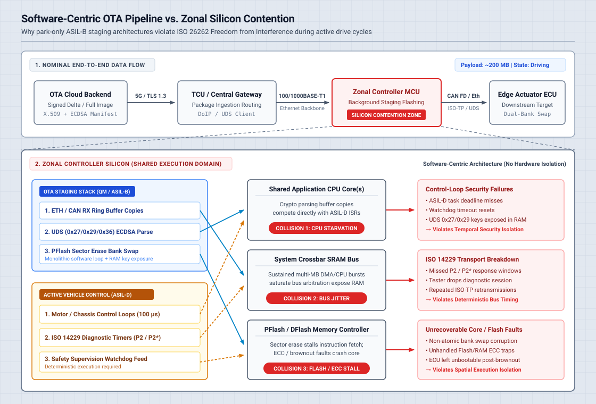

**Why Pure Software-Managed Updates Violate ISO 26262 Freedom from Interference**

*By Takt Research Lab*

Cloud-to-vehicle Over-The-Air (OTA) updates sound straightforward in a system diagram: stream a 200-megabyte firmware package over 5G, route it through an Ethernet backbone, flash the target Electronic Control Unit (ECU) in the background, and verify the image. In vehicle integration, that pipeline breaks down under real-time bus load and memory contention.

As E/E architectures consolidate into zonal controllers handling multi-megabyte payloads, software-centric OTA stacks run out of CPU and bus margin. Moving high-bandwidth payloads while active control loops execute on the same silicon introduces timing violations, flash-erase stalls, and ISO 26262 Freedom from Interference (FFI) gaps that nominal bench tests rarely trigger.

---

## The Industry Baseline: Why OTA Stacks Are Scoped at ASIL-B

Across the automotive industry, OEMs and Tier-1 suppliers typically scope OTA download and staging stacks at **ISO 26262 ASIL-B** for practical engineering reasons. When the actual bank swap happens only while the vehicle is parked, classifying background staging at ASIL-B keeps verification effort manageable using standard OS memory protection and diagnostic checks.

Zonal consolidation and continuous connectivity have fundamentally altered these operating conditions. Firmware downloads now execute while the vehicle is driving actively, and payload sizes have scaled from kilobytes to hundreds of megabytes. Expecting software-centric ASIL-B partitions to sustain high-speed data transfers without disturbing active control tasks leaves too little timing and memory margin.

---

## Where Software-Centric OTA Breaks Down

When download software and bootloader routines run without hardware-enforced isolation, five distinct failure modes emerge:

1. **Exposed Keys and Certificates in UDS Services `0x27` & `0x29`:** Unlocking an ECU for flashing relies on diagnostic sessions via Unified Diagnostic Services (UDS, ISO 14229) Service `0x27` (Security Access) or its modern PKI counterpart, Service `0x29` (Authentication). In a software-centric implementation, cryptographic keys, session tokens, and certificate verification routines execute on standard application cores with key material resident in general-purpose RAM or flash. If an attacker—or a faulty application task—compromises the communication stack, shared assets become exposed to side-channel attacks, memory dumps, or buffer-overflow exploits that bypass security gating.
2. **Fragile Validation and Non-Atomic Flash Swaps:** Verifying incoming binary chunks and executing dual-bank flash swaps in software requires strict atomicity. In a monolithic software loop, manifest checks, block sequencing, and flash write routines share the same execution context. If a power brownout or communication drop occurs midway through a flash swap, software fallback routines rarely recover cleanly; a single corrupted pointer or incomplete write can leave the ECU unbootable.
3. **Missed Strict UDS Timings Under CPU Jitter:** Diagnostic transport protocols over CAN or Ethernet depend on strict adherence to ISO 14229 timing parameters—specifically server response times (`P2`, `P2*`) and block pacing (`BlockSize`, `STmin`). Software-driven ISO-TP handlers and flash-erase loops are vulnerable to CPU stalls and scheduling jitter. When a core stalls while erasing flash sectors, it can miss tight `P2` response windows, drop the diagnostic session, and trap the update in a retransmission loop.
4. **CPU Starvation and Control-Loop Bottlenecks:** Streaming large firmware images over CAN or Automotive Ethernet demands sustained throughput. If the main application core is tied up copying payloads, managing ring buffers, and parsing X.509 certificates or ECDSA signatures in software, it has few cycles left for deterministic tasks. Real-time control loops—such as motor control or vehicle dynamics—can be starved of CPU time, leading to missed deadlines and watchdog resets.
5. **Unhandled Memory Faults and Flash ECC Crashes:** During active flash programming, a stray pointer, stack overflow, or uncorrectable Flash/RAM Error-Correcting Code (ECC) fault is critical. In a software-centric environment without hardware-enforced isolation, a memory fault during a flash write cycle corrupts execution state and crashes the core, leaving no path for orderly recovery.

---

## Why End-to-End ASIL-D Software Does Not Scale

To mitigate these failures, some teams default to classifying the entire OTA stack as **ASIL-D**. In practice, that approach does not scale. Forcing thousands of lines of transport protocols, memory allocators, and cryptographic libraries to meet ASIL-D software verification metrics drives up engineering cost, bloats code size, and slows down high-speed data transfer with redundant safety checks.

---

## Shifting Safety Boundaries from Software to Silicon

Instead of layering additional ASIL-D supervision logic onto software stacks, modern zonal architectures partition the OTA workload across dedicated hardware domains:

* **Offload packet routing** from main application cores to hardware routing engines (such as CAN/Ethernet DMA and routing accelerators) to prevent CPU starvation during multi-megabyte transfers.
* **Confine session management and staging** to standard QM or ASIL-B software partitions, avoiding ASIL-D verification overhead across the transport stack.
* **Isolate critical operations**—cryptographic verification, flash programming, and safety supervision—inside hardware-enforced security and safety domains where bus controls and memory protection prevent cross-domain interference.

In **Part II**, we will examine how next-generation microcontrollers use hardware packet routing, hardware security modules, lockstep cores, and bus-level firewalls to enforce ASIL-D Freedom from Interference without certifying the entire stack to ASIL-D.

---

## References & Standards

1. **ISO 26262-6:2018**, *Road vehicles — Functional safety — Part 6: Product development at the software level* (Section 7 & Annex D: Freedom from interference between software elements regarding timing, execution, and memory).
2. **AUTOSAR Classic Platform Specification**, *Requirements on Operating System (SRS_Os)* and *Specification of Memory Protection* (MPU-based spatial isolation and timing protection budgets for mixed-ASIL partitions).
3. **ISO 14229-1:2020**, *Road vehicles — Unified diagnostic services (UDS) — Part 1: Application layer* (Diagnostic session control, Service `0x27` Security Access, Service `0x29` Authentication, and `P2` / `P2*` server timing parameters).
4. **ISO 21434:2021**, *Road vehicles — Cybersecurity engineering* (Cryptographic key lifecycle management, trust anchor isolation, and protection of diagnostic authentication assets).
5. **EVITA / SHE Hardware Security Module Specifications**, *Secure Hardware Extension (SHE) Functional Specification* (Hardware-isolated key storage and cryptographic verification boundaries).
6. **ISO 24089:2023**, *Road vehicles — Software update engineering* (Target ECU integrity verification, power-loss resilience, and rollback/recovery requirements during software updates).
7. **ISO 15765-2:2016**, *Road vehicles — Diagnostic communication over Controller Area Network (DoCAN) — Part 2: Transport protocol and network layer services* (Segmented multi-frame transfer flow control, `BlockSize`, `STmin`, and `N_As` / `N_Bs` / `N_Cr` timing constraints).
8. **ISO 13400-2:2019**, *Road vehicles — Diagnostic communication over Internet Protocol (DoIP) — Part 2: Transport protocol and network layer services* (High-throughput Ethernet diagnostic payload streaming).
